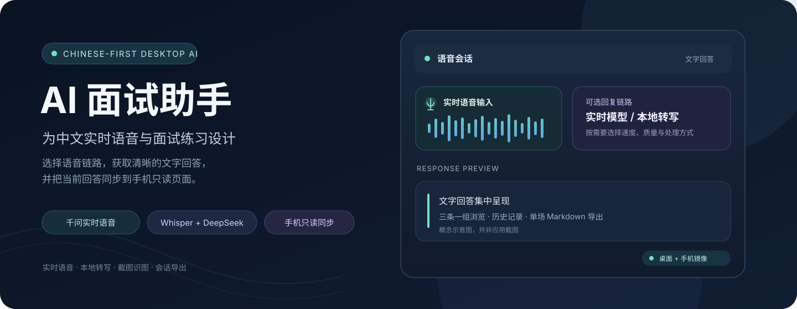
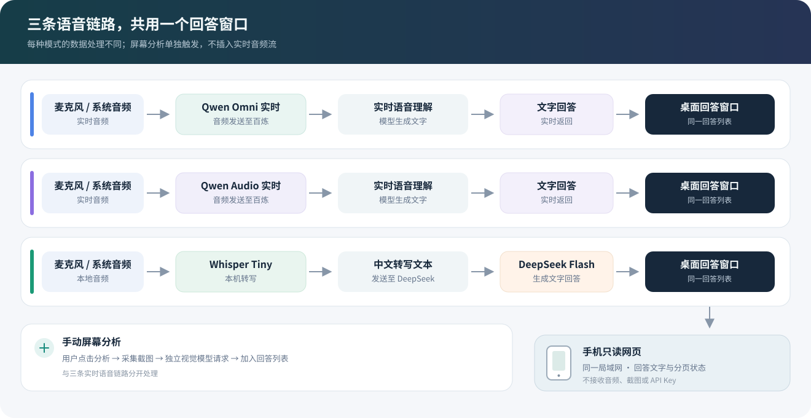

# AI 面试助手

**面向中文语音交互、模拟面试与会话复盘的桌面 AI 助手。**

AI 面试助手把实时语音、语音转写、截图分析和模型回答集中到一个桌面工作流中。你可以按需要选择千问实时语音，或选择本地 Whisper 转写后由 DeepSeek 生成文字回答；回答也可以通过同一局域网同步到手机只读页面。

**English:** A Chinese-first Electron desktop assistant with Qwen real-time voice, local Whisper transcription with DeepSeek responses, optional screenshot analysis, and a read-only phone companion.

> 本项目由 **L3n3L** 维护，是基于 [sohzm/cheating-daddy](https://github.com/sohzm/cheating-daddy) 的非官方衍生项目。项目已进行中文化和品牌调整，与上游没有隶属或背书关系；来源与许可证说明见 [NOTICE.md](NOTICE.md)。

[功能概览](#功能概览) · [选择语音链路](#选择适合自己的语音链路) · [快速开始](#快速开始) · [手机同步](#手机只读同步) · [数据流与隐私](#数据流与隐私) · [许可证](#许可证与来源)

## 为什么做这个项目

中文面试练习和语音沟通常常要在录音、转写、模型请求和笔记之间来回切换。AI 面试助手将这些步骤收进一个桌面应用，并让用户按质量、速度和数据处理方式选择链路：

- **中文优先**：简体中文界面、普通话设置和中文场景提示词。
- **三条语音链路**：千问 Omni 实时语音、千问 Audio 实时语音、本地 Whisper 转写加 DeepSeek 回复。
- **回答以文字呈现**：语音模式返回文字，便于阅读、回看和复制。
- **按需分析屏幕**：手动触发截图分析，走单独的视觉模型请求，不混入实时音频流。
- **手机只读镜像**：在同一局域网内用手机浏览器查看当前回答。
- **记录可带走**：浏览历史会话，并将单场记录导出为 Markdown。

## 选择适合自己的语音链路

| 模式 | 默认模型 | 音频如何处理 | 需要配置 |
| --- | --- | --- | --- |
| **千问 Omni 实时语音** | <code>qwen3.8-omni-flash-realtime</code> | 音频发送到千问实时接口，模型直接理解语音并返回文字 | 百炼 API Key、与 Key 同地域的 Workspace ID |
| **千问 Audio 实时语音** | <code>qwen-audio-3.1-realtime-plus</code> | 音频发送到千问实时接口，模型直接理解语音并返回文字 | 百炼 API Key |
| **DeepSeek + 本地 Whisper** | <code>deepseek-flash</code> + Whisper Tiny | Whisper 在本机将音频转成文字，再把转写文本发送给 DeepSeek | DeepSeek API Key；首次使用自动下载约 75 MB 的 Whisper Tiny |

两种千问模式面向实时语音对话，模型版本不同，用户可按偏好的速度和回答质量选择。DeepSeek 模式把**语音转写**留在本机；生成回答仍需把转写文字发送到 DeepSeek。

图示为数据流说明，不是应用截图。屏幕分析是单独的手动操作：采集当前截图后发送给所选视觉模型，结果进入同一回答列表。

## 功能概览

### 实时语音与文字回答

选择千问实时链路后，应用把音频交给对应实时语音接口，并在桌面回答窗口显示模型返回的文字。两条千问链路彼此独立，可以在设置中切换。

### 本地转写与 DeepSeek

DeepSeek 模式使用本地 Whisper Tiny 多语言模型识别中文普通话，再把转写文本交给 DeepSeek 生成回答。Whisper 模型在首次使用时下载一次，之后保存在本地数据目录中。

### 截图识图

点击“分析屏幕”后，应用采集当前屏幕并调用视觉模型分析。千问语音模式的截图识图走独立的 <code>qwen3-vl-plus</code> 请求；它不会改变实时语音链路。DeepSeek 模式下，截图和文字输入会发送给 DeepSeek。

### 三条一组的回答分页

回答窗口每页显示最近所在组的最多三条回答。使用 Ctrl + ← / →（macOS：⌘ + ← / →）切换前后回答组。Ctrl + ↑ / ↓（macOS：⌘ + ↑ / ↓）滚动回答窗口；连接手机时，也会向手机页面发送对应方向的滚动指令。

### 历史记录与导出

历史页面可以查看单场会话的对话详情，并通过“导出面试记录”将该场记录保存为 Markdown 文件，方便个人复盘和归档。

## 快速开始

### 运行源码

当前 GitHub 仓库**没有公开的预编译 Release 安装包**。有 Node.js 和 npm 的用户可以从源码启动：

~~~bash
git clone https://github.com/L3n3L/ai-interview-assistant.git
cd ai-interview-assistant
npm ci
npm start
~~~

### 配置模型

1. 在应用中选择一种语音模式。
2. 在对应服务平台创建 API Key，并粘贴到应用设置中。
3. 使用千问 Omni 时，再填写与 API Key 同地域的 Workspace ID。
4. 选择音频来源和中文普通话设置，然后开始会话。

- [阿里云百炼控制台](https://bailian.console.aliyun.com/)：用于千问实时语音与视觉模型。
- [DeepSeek API Keys](https://platform.deepseek.com/api_keys)：用于 DeepSeek 回复。

API Key 保存在本地应用配置中。请勿把真实 Key、日志或个人会话记录提交到 GitHub。

## 手机只读同步

电脑和手机连接到同一局域网后，在回答窗口底部悬停或点击手机同步图标，即可查看连接二维码和地址。手机浏览器打开后会实时显示当前回答，并跟随电脑切换回答分页；手机页面只展示回答内容和主题切换，不提供控制电脑的操作。

手机同步只镜像回答文字，不传输音频、截图或 API Key。切换 Wi-Fi 或 USB 网络共享后，请使用应用显示的对应网络地址。

## 数据流与隐私

| 操作 | 发送内容 | 目的地 |
| --- | --- | --- |
| 千问实时语音 | 实时音频 | 阿里云百炼对应的实时语音模型 |
| DeepSeek 语音模式 | 本地 Whisper 生成的转写文字 | DeepSeek API |
| 屏幕分析 | 用户手动触发时采集的屏幕截图 | 当前模式配置的视觉模型 |
| 手机同步 | 当前会话的回答文字与分页状态 | 同一局域网中的手机浏览器 |

DeepSeek 语音模式的 Whisper 转写在本地执行；千问实时语音模式会把音频发送给千问服务。截图只在用户主动触发分析时采集。模型服务提供方的数据处理方式受其各自的服务条款和隐私政策约束。

配置、凭据、历史记录和运行日志保存在本地数据目录。Windows 用户可以在启动应用前用 <code>CHEATING_DADDY_DATA_DIR</code> 指定目录，例如：

~~~powershell
$env:CHEATING_DADDY_DATA_DIR = 'D:/AI-Interview-Assistant/Data'
npm start
~~~

当前 Windows 源码默认数据目录仍在 [src/storage.js](src/storage.js) 中指定；向其他用户分发前，建议先检查并按目标环境设置。

## 使用边界

请将本项目用于模拟面试、学习复盘，或已获得明确许可的辅助场景。参加招聘面试、考试或其他测评时，请遵守主办方关于 AI 和外部辅助工具的规则；不要在明确禁止的场景中隐瞒使用。窗口显示和屏幕捕获结果会因操作系统、驱动和会议软件而不同，本项目不保证在屏幕共享中不可见。

## 反馈与参与

遇到问题或有改进建议，请到 [GitHub Issues](https://github.com/L3n3L/ai-interview-assistant/issues) 提交，并附上系统版本、所选模式和相关错误日志。提交前请移除 API Key、个人信息和会话内容。

## 许可证与来源

本项目以 **GPL-3.0** 发布。它是基于 [sohzm/cheating-daddy](https://github.com/sohzm/cheating-daddy) 修改和再发布的衍生项目；分发时请保留 GPL-3.0 许可证及上游来源说明。详细信息见 [LICENSE](LICENSE) 和 [NOTICE.md](NOTICE.md)。
