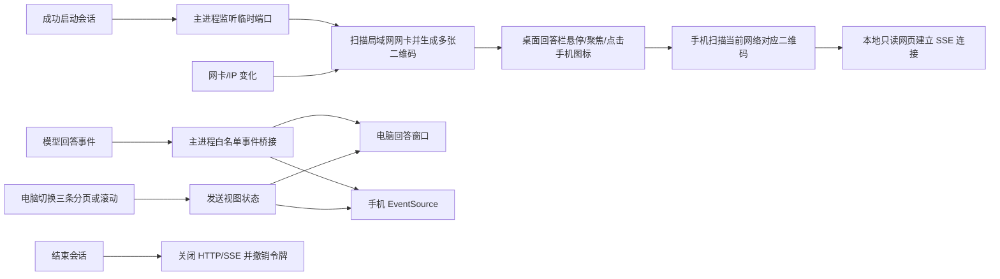
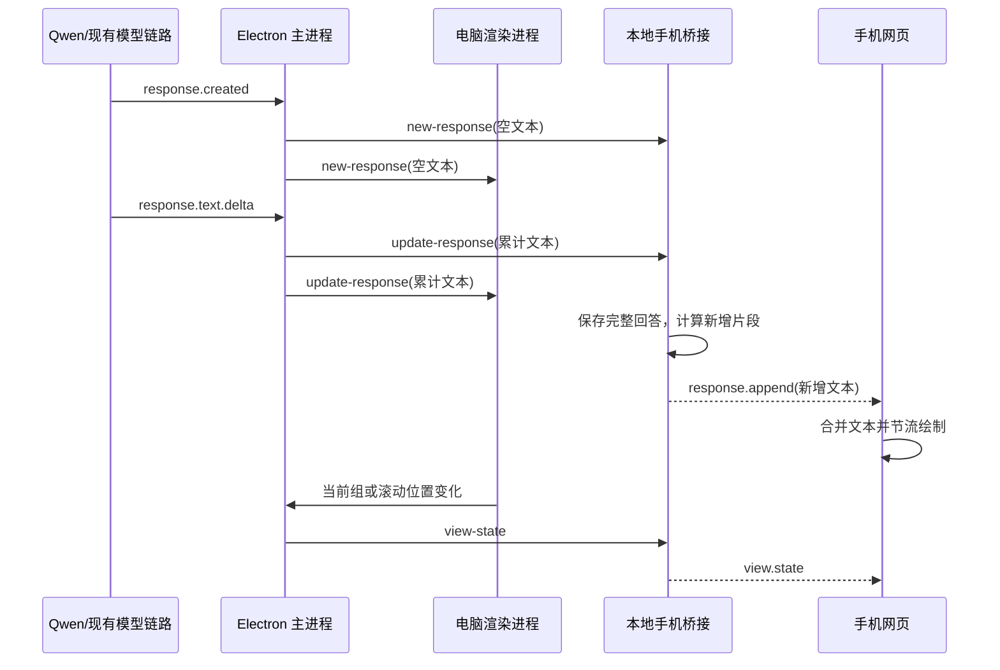

# 手机只读伴侣屏：执行复盘

## 已实现的行为

- 用户开始一场会话后，电脑主进程启动临时本地 HTTP 服务；结束会话或退出应用时关闭服务并撤销本场令牌。
- 回答栏显示手机图标。鼠标悬停、键盘聚焦或点击时展开二维码；列表按可用网卡分别显示 Wi-Fi、USB 网络共享或有线地址。
- 手机页的静态样板内容只用于本地预览；扫码打开真实会话时立即替换为“正在连接”占位，收到快照后才显示本场回答，避免把样板题目误认为真实回答。
- Windows 上读取网卡描述以识别 USB tethering 和虚拟网卡；地址列表每 5 秒刷新，检测到适配器/IP 变化时重新生成对应二维码。
- 每个二维码包含当前电脑的局域网 IPv4、临时端口和随机会话令牌。切换网络后，手机需扫描新网络对应的二维码；原连接会因旧 IP 不再可达而中断。
- 手机页面只接收回答快照与增量回答、当前三条分页位置、电脑回答区滚动比例。手机自身没有发送、翻页或控制电脑的接口。
- 回答来自现有模型事件，经主进程同时广播给桌面窗口和手机网页；不会为手机重复调用模型。
- 手机只展示 AI 回答，不传送或展示音频、转写、截图、API Key。

## 数据流

## 真实用户场景模拟

以 Qwen 实时模式为例：电脑当前 Wi-Fi 地址是 `192.168.1.20`，用户开始会话，手机扫描回答栏里 Wi-Fi 项对应的二维码。其他模式同样只把桌面已有的回答事件交给桥接。

面试官问：“请设计一个 O(1) 的 LRU 缓存，说明数据结构和淘汰流程。”模型回答示例：“用哈希表按 key 找节点，用双向链表维护最近使用顺序。`get` 命中后把节点移到表头；`put` 更新或插入表头，超过容量时删除表尾，再从哈希表移除对应 key。”随后面试官追问：“缓存满时为什么淘汰表尾？”这两句提问及音频仍只走现有模型链路；手机只收到两段模型回答。

| 时点                | 数据与事件                                                                                                                                              | 手机端结果                                                                 |
| ------------------- | ------------------------------------------------------------------------------------------------------------------------------------------------------- | -------------------------------------------------------------------------- |
| 开始会话            | 模型连接成功后，主进程监听临时端口、生成会话令牌，并在后台枚举网卡。音频仍走原模型链路。                                                                | 此时还没有回答数据。                                                       |
| 扫码打开            | 手机 `GET /p/<token>` 获取网页，再通过 `GET /events?token=...` 建立 SSE。                                                                               | 收到当前状态快照；没有转写、音频、截图或 Key。                             |
| 面试官提问          | 音频按原有模式送到 Qwen；主进程只把模型产生的回答事件交给桥接。                                                                                         | 手机看不到音频或转写。                                                     |
| 回答生成            | `response.created` 建立空回答；之后模型给出的累计文本在主进程与电脑端继续沿用。桥接比较新旧文本，向手机发新增片段；若模型修订了已有文本，则发完整替换。 | 增量显示回答；最多每 80ms 重绘一次，避免每个 token 都重建整页。            |
| 连续问答到第 4 条   | 回答数组从 3 条变成 4 条；若电脑当时停留在最新组，桌面与桥接都切到第 2 组。若用户正在看旧组，则不强行跳页。                                             | 仍跟随电脑当前三条。                                                       |
| `Ctrl+Left/Right`   | 桌面改变当前回答索引，通过 IPC 更新桥接的 `pageStart`。                                                                                                 | 只在换组时重建回答内容；滚动事件只更新手机滚动位置，不重解析 Markdown。    |
| `Ctrl+Up/Down`      | 桌面滚动回答区，滚动比例经 IPC 和 SSE 发送。                                                                                                            | 按手机可视区域的比例同步滚动。手机本地滚动只影响手机阅读，不反向控制电脑。 |
| Wi-Fi 切到 USB 共享 | 服务继续监听同一端口；最多约 5 秒检测到新 IP 并换出 USB 二维码。                                                                                        | 旧 IP 的连接可能断开；手机需要扫描新二维码，连接不会跨网自动迁移。         |
| 手机短暂断网        | EventSource 尝试重连；重连成功后服务重新发送完整当前快照，而不是补放所有历史事件。                                                                      | 以服务端最新答案、分页和滚动状态恢复，不会重复追加断线期间的增量。         |
| 结束会话            | 电脑先结束采集，再向主进程请求关闭桥接；桥接发送 `session.ended`、关 SSE、撤销令牌并关闭监听端口。                                                      | 显示“会话已结束”，停止无限重连。                                           |

### 一条回答的具体走向

模型原始音频、转写和截图不会进入手机桥接；这条新链路仅复用模型已经产出的回答文本。

## 状态风险复盘

- **两份答案状态**：桌面渲染进程与主进程桥接各自维护回答数组，新增、撤销和“停留旧页时不跳到最新页”的规则必须保持一致。当前对应处理已经对齐，但它是最主要的状态漂移风险。后续改分页规则时应同步改两处，或再抽成共享 reducer。
- **流式文本频繁更新**：模型 API 给出累计全文时，若每次都原样发给手机，长回答会重复传输大量前缀。当前桥接对前缀相同的更新只发新增片段；手机合并后仍保留完整答案。替换文本时才发完整内容。
- **手机重绘与滚动**：桌面滚动事件可能每帧到达。手机现在对滚动只改 `scrollTop`，不重建答案 DOM；模型文本更新合并到约 80ms 一次的页面绘制，避免高频 Markdown 解析造成耗电、抖动或滚动跳回。
- **取消生成**：已收到的部分回答会先显示；如果模型随后报告取消，桥接会删除最后一条并发送撤销事件。手机断线重连时拿到的是撤销后的快照。
- **新回答到达时的分页**：桌面和桥接使用同样的“是否处于最新组”规则。用户停在历史组时，新答案不会抢走当前阅读位置。
- **网络切换**：只更新二维码不能让已有 TCP/SSE 连接跨网迁移。必须重新扫新地址；客户端隔离、防火墙或电脑与手机不在同一可达网段时，没有云端中继兜底。
- **分页与滚动的精度**：分页能精确同步到同组三条；滚动按比例映射。手机较窄导致换行和内容高度不同，因此能同步大致阅读位置，不能保证落在完全相同的段落。
- **HTTP 与配对凭据**：本地传输不是 TLS。拿到二维码令牌的人能在该会话和可达网络内读取答案；不要分享二维码。会话结束后令牌失效。
- **答案范围**：桥接快照保留本场所有回答，手机只显示当前组三条；不会把逐字稿、音频、截图或密钥复制进手机状态。

整体上，回答与分页数据流能覆盖常规对话、取消、重连和网卡变更；剩下需要接受的边界主要是网络切换要重扫，以及跨设备滚动只能按比例近似。模型音频到云端的既有链路不因手机桥接而改变。

## 网络变化处理

参考 `codex-phone-connect` 的 `NetworkConnectionMonitor`：每 5 秒比较一次活动网卡地址列表；本项目使用 Node 的网卡地址枚举，并在 Windows 上补充 `Get-NetAdapter` 描述，用于将 USB tethering 与 Wi-Fi、有线网卡区分。二维码在同一场会话期间使用同一个临时端口和令牌，IP 改变后只更新地址和二维码。

本桥接不使用公网域名或云端中继。手机与电脑需要有可互相访问的本地链路。更换 Wi-Fi、USB 共享或其他网络后，重新扫描新地址的二维码即可；如果新网络启用了客户端隔离，或 Windows 防火墙阻止该应用接收局域网连接，手机将无法连入。

## 只读与数据边界

- 服务只接受 GET；手机浏览器用 SSE 订阅状态，服务没有手机控制电脑的写入路由。
- 服务只接收本地 IPv4 客户端（RFC1918、共享地址段或链路本地地址），并校验 Host/Origin；每场会话使用不可预测的随机令牌，最多允许 4 个手机订阅。
- 局域网传输使用 HTTP；二维码令牌应只在自己的设备间使用，不要转发给其他人。
- Markdown 输出经过 DOMPurify 清理后显示。
- 本地手机桥接不会把数据送到第三方；项目原有模型链路仍按原有配置向模型服务发送音频或文本。
- 这是一块只读同步屏；电脑仍是唯一的会话和分页状态来源。

## 快捷键

- `Ctrl+Left/Right`：上一组/下一组三条回答，并同步手机当前组。
- Windows `Ctrl+Up/Down`：滚动电脑回答区，并同步滚动位置；窗口上移/下移改为 `Ctrl+Alt+Up/Down`。
- 已保存的旧默认快捷键会迁移到新默认值；用户自行改过的快捷键保留。

## 相关实现

- `src/utils/phoneCompanion.js`：本地 HTTP/SSE 服务、局域网地址和二维码发现、会话令牌、回答/视图事件广播。
- `src/components/views/AssistantView.js`：二维码入口、三条分页、电脑滚动状态同步。
- `src/components/app/CheatingDaddyApp.js`：会话启动、快捷键视图状态转发。
- `src/index.js`：IPC 边界和应用退出清理。
- `src/utils/gemini.js`：将现有回答事件转发到手机桥接。
- `docs/phone-companion-sample.html`：手机网页与静态样板预览。
